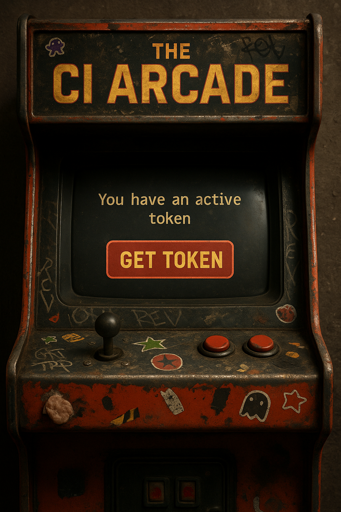
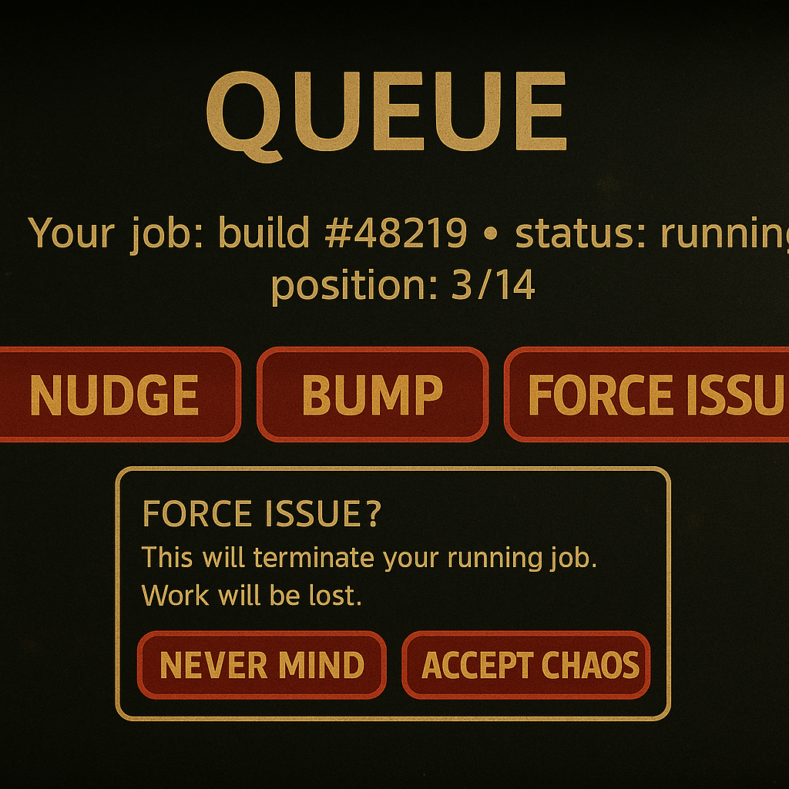
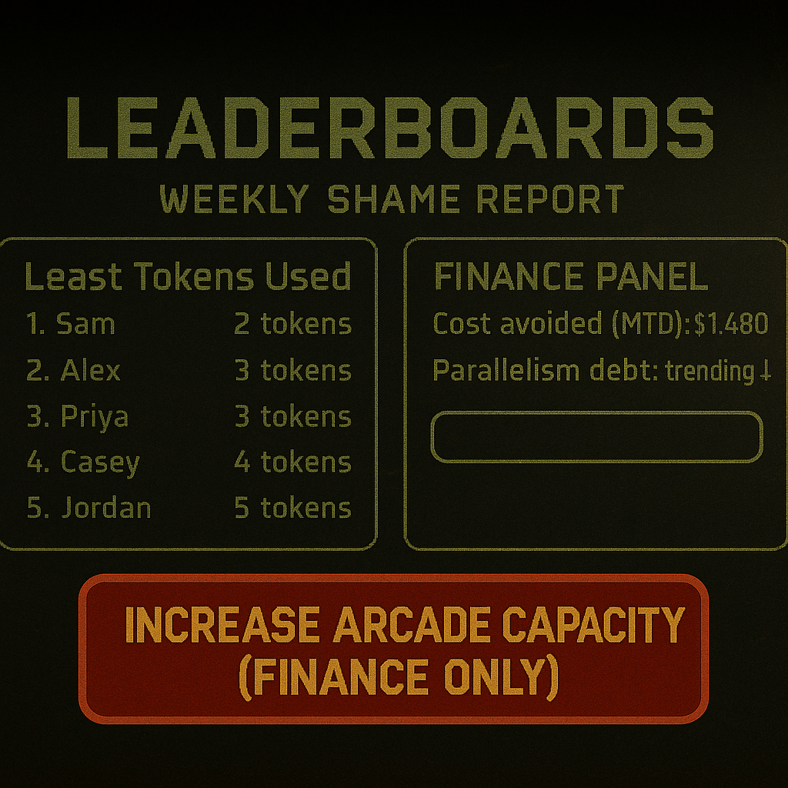

A fairness layer for CI that saves money by slowing you down just enough.

## Table of Contents
- [TL;DR](#tldr)
- [The Pitch](#the-pitch)
- [Core Mechanics](#core-mechanics)
  - [Token lifecycle](#token-lifecycle)
  - [Golden path flow](#golden-path-flow)
  - [Sequence diagram](#sequence-diagram)
  - [Token state machine](#token-state-machine)
- [UI Concepts](#ui-concepts)
- [Workflows](#workflows)
- [Pricing Theory](#pricing-theory)
- [SLOs](#slos)
- [Governance and Compliance Theater](#governance-and-compliance-theater)
- [Change Management](#change-management)
- [Behavioral Design](#behavioral-design)
- [FAQ](#faq)
- [Launch Assets](#launch-assets)
- [How We "Measure Success"](#how-we-measure-success)
- [Appendix: Forced Issuance Flow](#appendix-forced-issuance-flow)

## TL;DR
CI is too fast, engineers are too parallel, and cloud bills are too real.  
The CI Arcade introduces a token-gated queue that meters the blast radius of human enthusiasm. One job at a time. Sometimes.

---

## The Pitch
- Cut CI concurrency without saying "we cut CI concurrency"
- Align engineering behavior with finance targets using playful "game" mechanics
- Make throughput feel like a privilege you earn, not a utility you expect

---

## Core Mechanics
You don’t run CI. You buy a turn.

### Token lifecycle
- One active token per user. No token, no CI
- Tokens are consumed on job completion
- Forced issuance lets a user eject their currently running job to get a fresh token. Brutal but fair

### Golden path flow
```
1. User requests token generation.
   - Check for existing active token.
     - If active token exists: Notify user (cannot generate new token).
     - If no active token: Generate new token and mark as active.

2. User requests forced token issuance.
   - Check for active job.
     - If job is running: Terminate job, mark existing token as invalid.
   - Generate new token and mark as active.

3. User provides active token to run CI job.
   - Check token status.
     - If valid: Run CI job, mark token as used upon completion.
     - If invalid: Notify user (token no longer valid).

4. Log CI job result and token used.
   - Provide feedback to user about job outcome.
```

### Sequence diagram
<div class="mermaid">
sequenceDiagram
  actor Dev as Developer
  participant TA as Token API
  participant CQ as CI Queue
  participant ER as Executor Runner
  participant LG as Logger

  Dev->>TA: Request token
  TA-->>Dev: Token or "you already have one"
  Dev->>CQ: Submit job with token
  CQ->>TA: Validate token
  TA-->>CQ: Valid
  CQ->>ER: Start job
  ER-->>CQ: Job finished (success/fail)
  CQ->>TA: Mark token used
  CQ->>LG: Log job result + token id
  LG-->>Dev: Feedback summary
</div>

### Token state machine
<div class="mermaid">
stateDiagram-v2
  [*] --> None
  None --> Active: Generate

  Active --> Used: Job completes
  Active --> Invalid: Force issue (kill running job)
  Invalid --> Active: New token generated
  Used --> Active: New token generated
</div>

---

## UI Concepts
No code. Just vibes.

### 1) Home


- Big "Get Token" button
- "You have an active token" banner with a sad timer that counts up, not down

### 2) Queue + Force Issue


- Status + position in line
- Nudge/Bump controls
- Destructive Force Issue modal with "I accept the chaos"

### 3) Leaderboards + Finance


- Least Tokens Used (weekly)
- Finance panel with "Increase Arcade Capacity (Finance only)"

---

## Workflows

### "Happy" path
- Developer requests token
- Gets one
- Runs job
- Token is marked used when job completes

**Result:** Single-flight behavior. Cheap. Calm. Boring. Perfect.

### "Panic refactor" path
- Developer spams commits
- Sees "active token exists"
- Tries Force Issue
- Running job is terminated, token invalidated, new token created
- Runs new job

**Result:** The Arcade discourages thrash with self-inflicted pain. Finance smiles.

### "Oops stale token" path
- Developer tries to run a job with an invalid token
- Gets told it’s invalid
- Must request a new token like a normal human

**Result:** Order restored. Savings continue.

---

## Pricing Theory
- Free tier: soft caps and passive shaming
- Team tier: hard caps, mandatory tokens, audit-grade logs
- Enterprise: quarterly workshops on "Mindful Builds," SSO, and a concierge to rename "slow" to "thoughtful"

---

## SLOs
- Token issuance P50 under 200 ms
- Queue visibility P95 under 1 s
- Job kill-on-force-issue P99 under 3 s
- Monthly target: CI spend reduced by 30% without anyone admitting why

---

## Governance and Compliance Theater
- Audit log stores:
  - user_id
  - token_id
  - job_id
  - action (issued, validated, consumed, invalidated, killed)
  - timestamps
  - reason (human text, e.g., "panic push")
- Retention: 13 months so you can draw bad trend lines during budget season
- "Separation of duties": only Finance can increase concurrency ceilings

---

## Change Management
- RFC 000: Rename "concurrency limit" to "Arcade Capacity"
- RFC 001: Replace "job cancellation" with "graceful prize reclamation"
- RFC 002: Introduce "Happy Hour" where tokens are free from 2–3 a.m. local time

---

## Behavioral Design
- Variable rewards: random "jackpot" tokens drop for people who commit less than 3 times a day
- Social proof: weekly email celebrating the Lowest Token User
- Loss aversion: visible countdown before a Force Issue kill, so you feel it

---

## FAQ
**Isn’t this just a mutex for humans?**  
Yes. That’s the point.

**Will engineers be slower?**  
Yes. Your cloud bill will be smaller. Pick your poison.

**What about flaky tests?**  
Great news. You’ll notice them less often because you run fewer jobs.

**How do I bypass this?**  
You don’t. Arcade Capacity is policy, not preference.

---

## Launch Assets

### One-pager diagram
<div class="mermaid">
flowchart LR
  A[Request Token] -->|Active exists| B[Notify: reuse it]
  A -->|No active| C[Generate Token]
  C --> D[Run Job with Token]
  D -->|Valid| E[Execute CI Job]
  D -->|Invalid| F[Notify: token invalid]
  E --> G[Mark Token Used]
  G --> H[Log: job + token + outcome]
</div>

### Poster copy
- Headline: "Ship less. Save more."
- Subhead: "Turns, not threads."
- Footer: "The CI Arcade. One coin per run."

### Slack announcement
> Arcade is live. You get one active token. Force Issue kills your job and gives you a new coin. Jobs without valid tokens are bounced. Leaderboards on Friday. Questions in #arcade-support.

---

## How We "Measure Success"
- CI spend down 25–40%
- PRs linger longer but merges still happen
- Engineers report "less chaos" while privately seething
- Finance approves your next pet project because you "found savings"

---

## Appendix: Forced Issuance Flow
<div class="mermaid">
sequenceDiagram
  actor Dev as Developer
  participant TA as Token API
  participant CQ as CI Queue
  participant ER as Executor Runner

  Dev->>TA: Force issue request
  TA->>CQ: Is there a running job for this user/token?
  alt Yes
    CQ->>ER: Terminate job now
    ER-->>CQ: Job killed
    CQ->>TA: Mark token invalid
  else No
    TA-->>TA: Nothing to kill
  end
  TA-->>Dev: New active token issued
</div>

